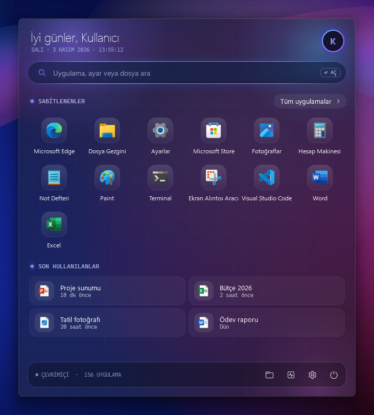
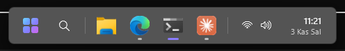
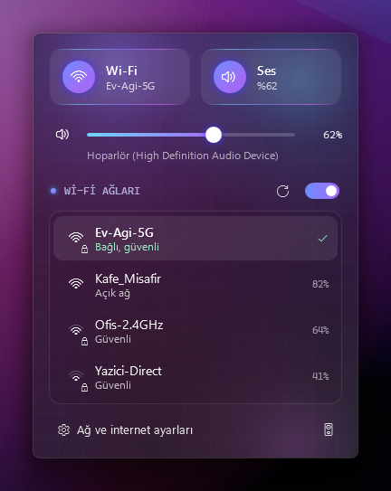
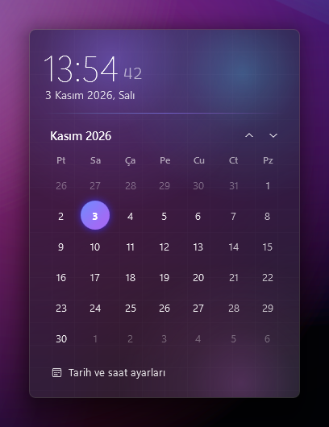
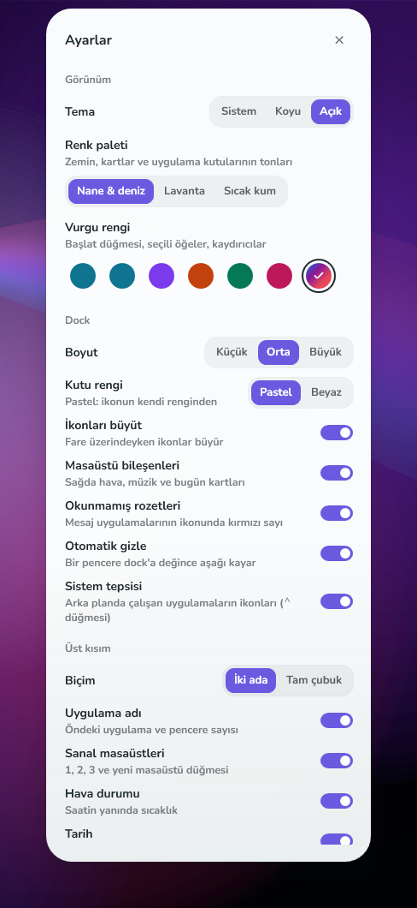
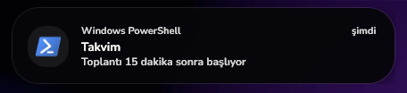

<div align="center">

# FloatingDock

**Windows 11 ve 10 için havada duran cam görev çubuğu, kendi Başlat menüsü ve üstte müziği gösteren bir ada.**

[](https://github.com/Enskygr234/FloatingDock/releases/latest/download/FloatingDock.exe)
&nbsp;




</div>

---

## Neler var?

### 🪟 Havada duran dock


- Ekranın altından ayrık, yuvarlak köşeli, akrilik cam görünüm
- Sabitlenmiş ve açık uygulamalar; çalışanların altında gösterge, öndeki pencere için mavi çizgi
- İkonları **sürükleyerek sırala**, dosya ya da uygulamayı dock'a **bırakarak sabitle**
- Uygulamaya sağ tık: yeni pencere, sabitle / kaldır, pencereleri kapat
- İkonun üstüne gelince pencerelerin **canlı önizlemesi** (tıkla → öne getir, ✕ → kapat)
- Fare üzerinde gezerken ikonlar yumuşakça **büyür**
- **Akıllı gizleme:** bir pencere dock'a değince aşağı kayar, fareyi ekranın en altına götürünce geri gelir. Büyütülmüş pencereler ekranın tamamını kullanır

### ✨ Kendi Başlat menüsü
Dock'taki logoya ya da klavyedeki **Windows tuşuna** basınca açılır.

- Saate göre selamlama, canlı tarih/saat
- **Arama:** uygulamalar, ayarlar (Wi-Fi, Ekran, Windows Update…), dosyalar ve web — ok tuşları + Enter
- Cam kutularda sabitlenen uygulamalar (sağ tık → sabitle / kaldır), son kullanılan dosyalar
- Harf gruplu **tüm uygulamalar** listesi
- Sabitlenenler arasında **ok tuşlarıyla** gezinme
- Kilitle / Uyku / Oturumu kapat / Yeniden başlat / Kapat
- Win+E, Win+D, Win+R gibi kısayollar aynen çalışır. İstersen dock'a sağ tıklayıp Windows tuşunu eski menüye bırakabilirsin

### 📶 Hızlı ayarlar, takvim ve bildirimler
<p>

&nbsp;

</p>

- Hızlı ayar kutucukları: Wi-Fi, Bluetooth, Rahatsız etme, sessiz, gece ışığı
- Ses ve **parlaklık** kaydırıcıları, dizüstünde **pil** durumu, çalan müzik için **medya kartı**
- Yakındaki ağlar sinyal gücüyle listelenir: tıkla → şifreyi yaz → bağlan. Kayıtlı ağı unut, bağlantıyı kes, Wi-Fi'ı aç/kapat
- Parlayan ses kaydırıcısı, tek tıkla sessize alma, kullanılan hoparlörün adı
- Saniyeli büyük saat ve Türkçe aylık takvim (fare tekerleğiyle aylar arasında gezin)
- **Bildirim geçmişi**: kaçırdığın bildirimler takvim panelinde birikir, saatin yanında nokta belirir

### ⚙️ Ayarlar ve tema


- **Açık / koyu tema** (ya da Windows'u takip et), buz mavisi ya da **Windows vurgu rengi**
- Dock boyutu (küçük / orta / büyük), ikon büyütme ve otomatik gizleme aç/kapat
- Dock'a sağ tık → **FloatingDock ayarları…** ya da hızlı ayarlardaki **Ayarlar** kutucuğu
- Windows'ta "animasyon efektleri" kapalıysa hareketler de kapanır

### 🎵 Ada (ekranın üstü)


- Spotify, YouTube ve tarayıcıda **çalan şey**: kapak, şarkı/sanatçı, kapağın renginde ekolayzer
- Üstüne gelince büyür: ilerleme çubuğu ve ⏮ ⏯ ⏭ düğmeleri
- Gelen **bildirimleri** uygulama ikonu, başlık ve metinle gösterir
- Tam ekran oyun/videoda kendini gizler

## Kurulum

1. **[FloatingDock.exe dosyasını indir](https://github.com/Enskygr234/FloatingDock/releases/latest/download/FloatingDock.exe)** (69 MB, .NET kurmaya gerek yok) — ya da [sitemden](https://enskygr234.github.io/?q=FloatingDock)
2. Çalıştır. İmzasız olduğu için Windows SmartScreen uyarı verebilir: **Ek bilgi → Yine de çalıştır**
3. Açılışta otomatik başlaması için dock'a **sağ tıkla → Windows açılışında başlat**

Gereksinim: **Windows 11** ya da **Windows 10 (1809 ve üzeri)**. Aynı exe iki sistemde de çalışır; Windows 10'da paneller Win10 tarzı keskin köşeli ve ince kenarlı açılır, cam bulanıklığı Windows 10'un kendi akrilik efektiyle (1803+) yapılır.

## Kaldırma / eski görev çubuğuna dönme

Dock'a **sağ tıkla → Dock'u kapat**. Windows görev çubuğu eski ayarlarıyla geri gelir.
Otomatik başlatmayı açtıysan önce aynı menüden kapat, sonra `FloatingDock.exe` dosyasını silebilirsin.

Program beklenmedik şekilde kapanırsa ve görev çubuğu geri gelmezse: `Ctrl+Shift+Esc` → Görev Yöneticisi → **Windows Gezgini**'ni yeniden başlat, ardından *Ayarlar → Kişiselleştirme → Görev çubuğu → Görev çubuğu davranışları → Görev çubuğunu otomatik olarak gizle* seçeneğini kapat.

## Gizlilik

- İnternete **hiçbir şey göndermez**, hiçbir sunucuya bağlanmaz. (Başlat menüsünde "web'de ara"ya basarsan arama yalnızca o an varsayılan tarayıcında açılır.)
- Çalan medya bilgisi Windows'un kendi medya arayüzünden alınır.
- Bildirimler, Windows'un yerel bildirim veritabanından (`%LOCALAPPDATA%\Microsoft\Windows\Notifications\wpndatabase.db`) **sadece okunarak** alınır; hiçbir şey kaydedilmez veya değiştirilmez.
- Wi-Fi şifreleri yalnızca Windows'un kendi kayıtlı ağ profiline yazılır (Windows ayarlarından bağlanmakla aynı); yanlış şifreyle oluşturulan profil hemen silinir.
- Bildirim geçmişi yalnızca bellekte tutulur, diske yazılmaz; program kapanınca silinir.
- Ayarlar `%LOCALAPPDATA%\FloatingDock\` klasöründe (`settings.json`) ve `HKCU\Software\FloatingDock` altında durur; hata olursa kayıt `error.log` dosyasına yazılır.

## Bilinen sınırlar

- Sistem tepsisi (arka plan uygulama ikonları) yok.
- Sadece ana ekranda çalışır; diğer monitörlerde Windows görev çubuğu kalır.
- Kurumsal (kullanıcı adı + şifre isteyen, 802.1X) Wi-Fi ağlarına panelden bağlanılamaz; panel bu ağlar için Windows ayarlarını açar.
- Windows'un kendi bildirim balonu da çıkmaya devam eder. İstersen *Ayarlar → Sistem → Bildirimler*'den balonları kapatabilirsin.

## Derleme

```
dotnet publish -c Release -r win-x64 --self-contained true -p:PublishSingleFile=true -p:IncludeNativeLibrariesForSelfExtract=true -p:EnableCompressionInSingleFile=true
```

Panelleri dock olmadan denemek için: `FloatingDock.exe --panel baslat|wifi|takvim [saniye]` (ekran görüntüsü için örnek verilerle: sonuna `--demo` ekle).

C# / WPF, .NET 10 · Lisans: [MIT](LICENSE) · Yapan: [Winterdeveloper](https://enskygr234.github.io)
